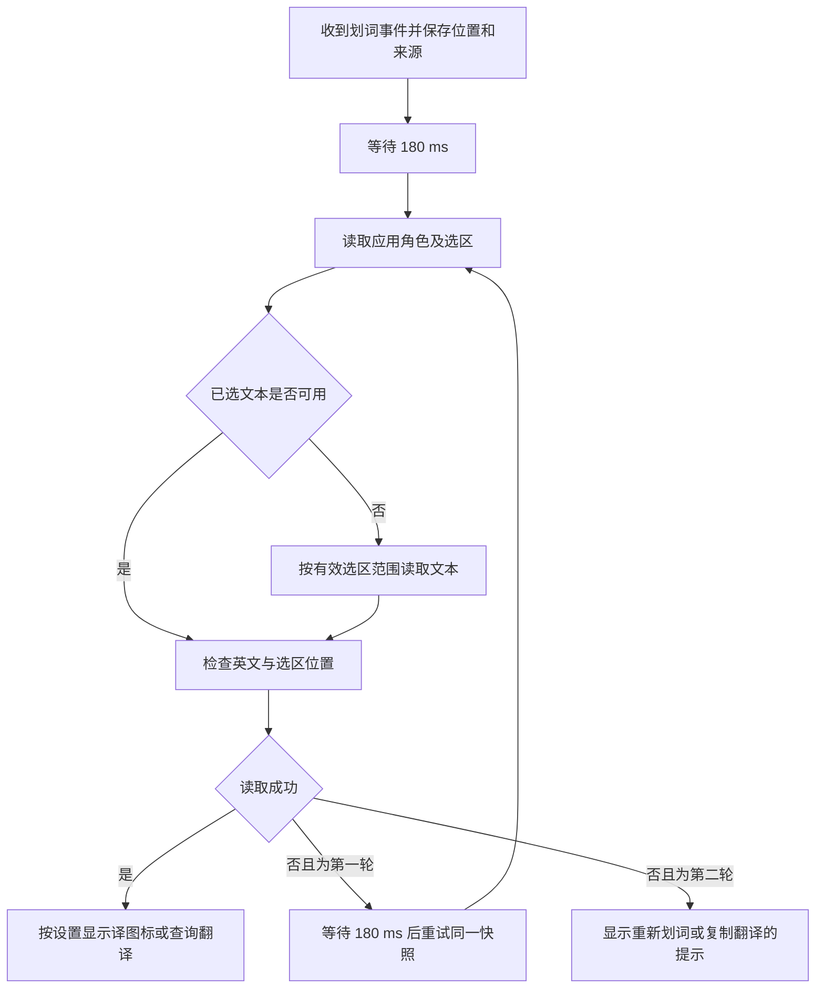

# Chrome 划词读取兼容修复

## 问题与证据

2026-10-22 用户截图中，Chrome 已选中 `prioritize`，HyperTranslate 显示辅助功能已授权、语言包已安装，但取词状态为「Google Chrome 未提供可读取的英文选区」。这说明已收到选择事件、读取未成功，不能仅由该提示断定 Chrome 永远不支持选区，也不能归因于语言包或词典。

现有实现未读取应用角色，每次事件只读取一次，并仅通过 `AXSelectedText` 获取文本。[Chromium 当前源码](https://chromium.googlesource.com/chromium/src/+/refs/heads/main/chrome/browser/chrome_browser_application_mac.mm)在 `accessibilityRole` 中按需启用辅助功能。这是本次补充角色读取与短暂重试的依据，不能替代对用户当前 Chrome 版本和页面的实测。

## 修改范围

- `SelectionService.swift`：读取公开的 `AXRole`，兼容浏览器按需初始化；首次未读到选区后，等待 180 ms 再尝试一次，最多两轮。
- 优先读取 `AXSelectedText`；缺失或空白时，按有效的 `AXSelectedTextRange` 调用公开的 `AXStringForRange`。排除空光标、负值、溢出范围和非英文返回结果。
- 重试沿用事件发生时的进程、鼠标和屏幕坐标；保留取消、来源进程、选区位置和请求代次校验，防止旧选区弹出。
- 失败提示改为「未读到……请重新划词；或复制后使用『翻译剪贴板』」，避免把一次失败描述为目标应用不提供选区。
- 不改变手动/自动弹出设置、引导页完成条件或翻译服务；不写入目标应用 AX 属性，不模拟复制，不自动读取剪贴板。

## 验证

- `bash scripts/test.sh`：49 项测试，46 项通过，3 项 `PanelPinTests` 因测试会话无法访问屏幕而跳过，0 失败。
- 本次新增 8 项回归测试，覆盖浏览器延迟暴露选区、重试次数限制、取消后不重试、读取期间取消丢弃结果、直接文本优先、范围取词兜底、无效范围和无英文结果过滤。原有鼠标移动、残留选区、键盘选区及副屏坐标测试通过。
- 测试针对当前工作区，包含已有未提交的朗读测试；本次仅提交取词修复、相关测试和文档，保留已有其他改动。
- `bash scripts/build_app.sh`：原生 Release 编译通过。首次在沙箱内的 `iconutil` 返回 `Invalid Iconset`；沙箱外重试同一脚本后，图标生成、应用签名及严格签名校验通过。
- 已退出旧进程并打开 `dist/HyperTranslate.app`，新版显示语言包已安装、辅助功能尚未授权。手动输入 `prioritize` 并查询，界面实测显示「vt. 按优先次序列出, 优先考虑」；该次联网例句不可用，单词释义正常。
- 现场 Chrome 的界面读取连续超时，尚未确认该页面的具体 AX 返回值。新版仍需用户重新授权后手动划词验收；测试和手动输入结果不能证明 Chrome 取词已恢复。

## 应用更新与复验

原生应用包输出到 `dist/HyperTranslate.app`。本次不调整已有版本号；运行中的旧进程需要退出后打开新包，才会使用修复。收藏和用户偏好不在应用包中。

本地 ad-hoc 签名随可执行文件变化，若新包提示未授权，按[使用说明](使用说明.md)重新添加实际应用路径；系统设置的旧开关不能证明新签名已获授权。

复验时在 Chrome 页面重新选择 `prioritize`，松开鼠标后等待图标出现，再点击「译」（当前默认手动弹出）。若仍失败，复制单词后使用菜单「翻译剪贴板」，并检查权限页的取词状态。点击「开始使用」只离开引导页，本身不会修复 Chrome 读取失败。
