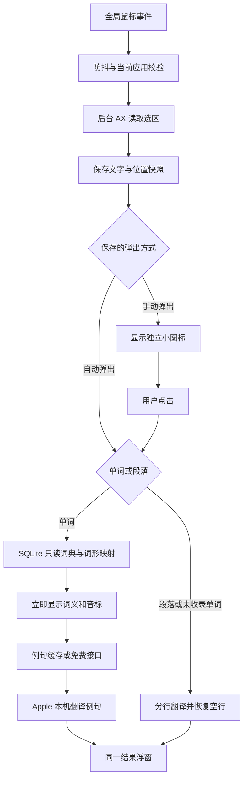

# HyperTranslate 开发说明

## 版本库

仓库地址：https://github.com/hehaiquan/HyperTranslate ，默认分支为 `main`。源码、测试、完整离线词库及第三方许可一并纳入版本管理；`.build/`、`.cache/`、`dist/` 和 `.DS_Store` 已排除。提交仓库不会修改已构建应用或系统授权。

### 版本提交记录

- 2026-10-19：将窗口拖动、单词收藏、玻璃外观、划词弹出设置和左侧竖排导航统一归入 `v1.0.6`，对应应用版本 1.0.6、构建号 7。此前 1.0.3–1.0.5 的调整过程保留在功能文档中，本次仅为当前完整源码创建附注 tag。
- 提交前运行 `bash scripts/test.sh`，34 项测试全部通过；`git diff --check` 与 `plutil -lint scripts/Info.plist` 通过。本次未重新生成应用安装包，也未补充 GUI 实机验收，既有验收边界见[窗口移动与单词收藏](窗口移动与单词收藏-2026-10-18.md)和[玻璃样式与划词弹出设置](玻璃样式与划词弹出设置-2026-10-19.md)。

## 构建与运行

依赖 Xcode 或匹配的 Apple Swift 工具链及 macOS SDK；本项目开发验证使用 Xcode 中的 Swift 6.4、macOS 27 SDK，部署目标为 macOS 15。Swift 语言模式采用 5，避免将 Swift 6 严格并发迁移与功能实现混在一起。系统框架之外没有 Swift 包依赖。

```bash
cd /Users/hehaiquan/code/HyperTranslate
bash scripts/test.sh
bash scripts/build_app.sh
open dist/HyperTranslate.app
```

`build_app.sh` 编译原生 Swift 程序、复制完整词库、生成图标并完成本地 ad-hoc 签名；不会安装应用、修改隐私授权或添加登录项。此处没有 Web 前端或前端构建。

编译缓存放在项目 `.cache/` 和 `.build/`。正式包输出 `dist/HyperTranslate.app`，支持在当前硬件平台重新构建。现成包为 arm64；如需 Intel 包，应在对应环境构建并单独验收。

内置 SQLite 词库已经生成，普通构建无需下载。重建词库时执行：

```bash
python3 scripts/prepare_dictionary.py --force
```

脚本固定 ECDICT 提交及源文件 SHA-256，下载文件不符会停止。词条 770,611 条，词形映射 58,618 条，数据库约 59 MiB。数据快照信息在 `ThirdParty/ECDICT-metadata.json`，上游许可原文随应用发布。

## 模块与数据流



- `HyperTranslateCore`：输入分类与长度校验、段落重建、请求代次保护、只读 SQLite 查询、例句解析及缓存。测试直接使用真实内置词库。
- 原生应用：AppState 管理查询和持久化的划词弹出方式，SelectionService 监听事件并在独立 actor 中读取 AX，PanelController 管理图标和唯一结果宿主，TranslationService 对接系统翻译，SpeechService 对接本机朗读。
- TranslationSession 只在 SwiftUI `translationTask` 回调的有效期内使用，不跨回调保存。支持策略选项时明确使用传统 `lowLatency` 模型，并以同一策略检查语言包。
- 新查询、外部关闭或取消会推进请求代次；所有晚到结果必须通过当前代次校验。会话 completion 还校验请求 ID，避免旧会话结束时完成新请求。
- AX 属性读取设定超时，并限制祖先和子树遍历次数。不使用私有 AX 属性、不修改目标应用的辅助功能状态、不模拟按键复制。
- 例句接口地址为 `https://api.dictionaryapi.dev/api/v2/entries/en/<word>`。外部响应的来源和许可只允许以 HTTP/HTTPS 链接打开。

## 验证方式

定向测试覆盖输入分类、长度边界、段落恢复、真实词库及音标缺失、不规则词形和多义词、SQL 参数绑定、异步旧结果、例句解析/去重/无收录/网络错误/格式错误/缓存/取消。

包内可执行文件提供诊断入口：

```bash
dist/HyperTranslate.app/Contents/MacOS/HyperTranslate --diagnose
dist/HyperTranslate.app/Contents/MacOS/HyperTranslate --diagnose --network
```

诊断读取真实打包资源、辅助功能授权及模型可用状态。`--network` 额外查询 `hello` 的公开例句，可能写入本机例句缓存；不请求辅助功能授权，不触发语言包下载。命令行的授权结果受启动上下文影响，GUI 应用是否获准取词，以应用准备页及实际跨应用结果为准。

自动测试不能替代跨应用验收。Safari、Chrome、Preview 文本 PDF 和 VS Code 需要分别在已授权的本机验证；扫描 PDF、画布式编辑器等无法保证暴露选区。实际完成和待验证事项见本次功能记录。

## 玻璃外观与弹出设置（1.0.4）

`GlassStyle.swift` 集中管理全窗玻璃、正文卡片及工具栏按钮。通过 `#available(macOS 26.0, *)` 使用系统 `glassEffect`；旧系统由 `NSVisualEffectView` 以 `behindWindow` 模式采样窗口背后的内容。尊重 `accessibilityReduceTransparency`，正文卡片使用半透明底色维持可读性。

`AppState.selectionPopupMode` 从 `UserDefaults` 的同名键恢复，值为 `manual` 或 `automatic`；缺少或无法识别时采用手动模式。`presentSelection` 在暂停/准备语言包时拦截，否则显示图标或使用快照原文及位置启动查询。切换模式时撤销等待中的 AX 读取并关闭临时内容，不修改已有取词防抖、来源进程校验和请求代次保护。
