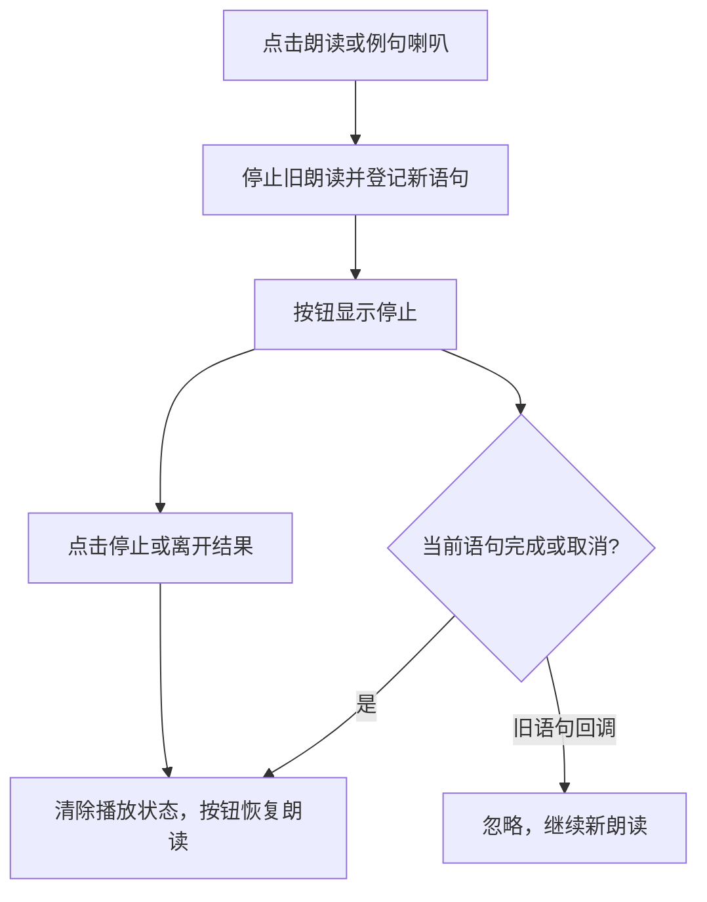

# 朗读结束后按钮状态修复

日期：2026-10-20；版本：1.0.8，构建号 9。

## 问题与修复

用户反馈单词读完后，顶部按钮仍显示「停止」。原来的完成、取消回调重新读取 `AVSpeechSynthesizer.isSpeaking`；若该属性仍为 `true`，界面无法恢复「朗读」。真实系统语音验证捕获到第二轮 `didFinish` 时该属性仍为 `true`，确认完成事件与忙碌属性不能混作同一状态。

改为保存当前朗读语句，在收到该语句的完成或取消回调后，直接清除播放状态。点击停止时立即清除当前语句和状态；切换单词、例句后，旧语句的延迟回调不能改变新语句的状态。

## 修改位置

- `Sources/HyperTranslate/SpeechService.swift`：跟踪当前语句，按回调归属恢复状态，支持注入合成器以复现状态延迟。
- `Tests/HyperTranslateAppTests/SpeechServiceTests.swift`：覆盖自然完成、系统取消、替换时旧回调、主动停止后的旧回调。
- `Sources/HyperTranslate/Views.swift`、`scripts/Info.plist`：更新应用版本。

## 验证与交付

- 修复前，4 项新增回归测试均失败，确认覆盖旧实现的问题。
- `bash scripts/test.sh`：38 项测试全部通过，其中包括新增的 4 项朗读回归测试。
- 使用实际 `SpeechService.swift` 与临时验证程序运行系统真实语音，连续两次朗读 `problem` 均收到自然完成事件、恢复空闲状态，并能再次朗读。第一次完成回调时系统 `isSpeaking=false`，第二次为 `true`；两轮服务状态均正确归零。回调语句均与提交对象相同。
- 临时验证程序不作为交付功能，验证后删除；上述真实系统验证覆盖服务及回调状态，不等同于完整界面验收。
- 原生 Release 编译、ad-hoc 签名、`codesign --verify --deep --strict`、Info.plist 格式检查、ZIP 完整性检查及 `git diff --check` 通过。
- 已退出旧进程并启动新版；界面检查确认 `problem` 的朗读操作能进入「停止」状态。自然完成后的按钮显示仍待最终人工确认，自动化观察期间结果页因窗口焦点切换被关闭，未据此声称界面完整验收通过。
- 应用包：`dist/HyperTranslate.app`；压缩包：`dist/HyperTranslate-1.0.8-macOS-arm64.zip`。
