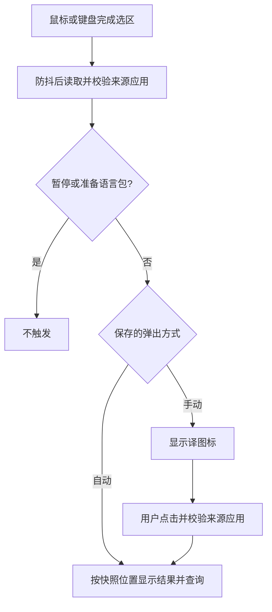

# 玻璃样式与划词弹出设置

日期：2026-10-19；版本：1.0.4（构建号 5）。

## 使用变化

- 浮窗和取词图标使用苹果风格玻璃底板，搭配蓝色强调色、连续圆角、细边缘高光和统一工具栏按钮；输入框、释义及设置区块使用浅色内卡片。
- macOS 26 及以上采用系统 Liquid Glass；macOS 15–25 使用 `NSVisualEffectView` 原生毛玻璃。适配系统深浅色；开启「降低透明度」后使用实色背景。
- 在「设置 → 选中后如何弹出」选择「手动弹出」或「自动弹出」。默认保持原来的手动方式，设置在重启后保留。
- 手动方式：选中英文后显示「译」图标，点击图标才查询。自动方式：选区读取完成后直接打开结果并查询。两者都使用捕获的文字和位置。
- 暂停划词或准备系统语言包期间，两种方式都不会触发；手动输入和剪贴板入口沿用原行为。切换方式会清理等待中的读取及临时结果。
- 原有窗口拖动、单词收藏、朗读和复制功能继续保留。

## 触发流程

## 修改位置

- `Sources/HyperTranslate/GlassStyle.swift`：系统玻璃及兼容材质、正文卡片、工具栏按钮。
- `Sources/HyperTranslate/Views.swift`：统一样式、设置分段选择器、随模式更新的说明和页脚。
- `Sources/HyperTranslate/PanelController.swift`：取词图标使用相同玻璃底板。
- `Sources/HyperTranslate/AppState.swift`：弹出方式恢复、保存及选区触发分流；未知设置值回到手动模式。
- `Sources/HyperTranslate/Application.swift`：接入选区分流，模式变化时取消尚未完成的读取并清理临时界面。
- `scripts/Info.plist`：版本更新为 1.0.4，构建号 5。
- `Tests/HyperTranslateAppTests/SelectionPopupTests.swift`：新增 5 项弹出行为及偏好持久化测试，使用独立偏好域，结束后清理。

## 验证记录

- `bash scripts/test.sh`：34 项通过，包括新增的手动不查询、自动直接查询且保持快照位置、暂停和准备状态拦截、重启恢复、未知值回退测试。
- 原生 release 编译通过。图标转换在受限沙箱内报 `Invalid Iconset`，沙箱外执行相同 `iconutil` 命令成功；随后完成 ad-hoc 签名，`codesign --verify --deep --strict` 通过。
- 新版应用已启动，检查了准备页和设置页截图；自动选项切换后说明及页脚同步变化，检查完成后恢复手动模式。
- 当前应用提示缺少辅助功能授权，未实际验收跨应用选区自动弹出。仍需在已授权应用中手动检查两种方式、鼠标移走后的定位，以及深色模式、降低透明度和旧系统材质效果。自动测试和界面截图不代表这些项目已完成实机验收。

## 更新使用

退出旧版后打开项目 `dist/HyperTranslate.app`。新版本改变了二进制签名；若取词未授权，按应用「权限与语言包」入口检查并重新授权实际使用路径。

构建方式见[开发说明](开发说明.md)，日常操作见[使用说明](使用说明.md)。

## 后续调整：左侧操作与更大窗口（1.0.5）

- 顶部操作按钮集中到标题栏左侧，依次为关闭、手动输入（非输入页显示）、收藏和设置；右侧应用名称及空白处继续支持拖动。
- 默认窗口宽度由 452 调整为 560；输入页高度由 500 调整为 640，结果、收藏、设置和准备页高度由 590 调整为 720。尺寸单位为 macOS 逻辑点，仍按屏幕可见范围约束。
- 修改 `Views.swift` 的标题栏排列及版本文字、`PanelController.swift` 的初始和页面尺寸，以及 `scripts/Info.plist` 的版本号；版本为 1.0.5，构建号 6。
- 原生 release 编译、`git diff --check`、Info.plist 检查及应用签名验证通过；启动新版后，通过准备页截图确认左侧按钮顺序及 560 × 720 的窗口布局。
- 本次为布局和尺寸调整，未新增测试，也未重复运行上一轮 34 项业务测试。跨应用划词等验收边界沿用上文。
- 应用包更新到 `dist/HyperTranslate.app`，压缩包为 `dist/HyperTranslate-1.0.5-macOS-arm64.zip`。

## 后续调整：独立左侧竖排栏（1.0.6）

- 操作入口改为窗口左侧的独立竖排侧边栏，宽 64 点；右侧为标题、页面内容和页脚。顶部关闭，随后是输入及收藏，设置固定在底部。
- 输入入口始终可见，当前页面入口使用蓝色高亮，并提供辅助功能选中状态；悬停说明及语言包准备期间禁用行为保留。
- 顶部应用标题及空白区域保留拖动能力，窗口保持上一版加大的默认尺寸。
- 修改 `Views.swift` 的整体布局及导航、`GlassStyle.swift` 的按钮尺寸参数，并将应用版本更新为 1.0.6（构建号 7）。
- 原生 release 编译和签名验证通过；启动后检查了准备页及输入页截图，确认左侧竖排布局、导航切换和输入页选中状态。`git diff --check` 和 Info.plist 检查通过。本次纯布局调整未新增或重复运行业务测试。
- 应用包更新到 `dist/HyperTranslate.app`，压缩包为 `dist/HyperTranslate-1.0.6-macOS-arm64.zip`。
