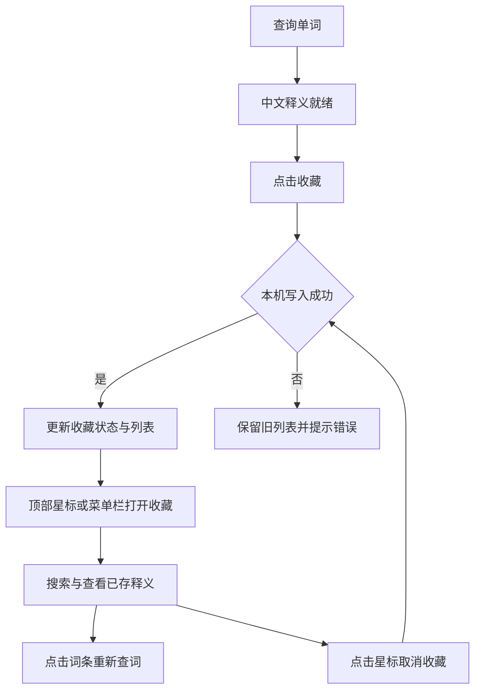

# 窗口移动与单词收藏（1.0.3）

## 功能与实现

- 窗口顶部应用名称和相邻空白区域提供独立的 AppKit 拖动视图，接收未激活状态下的首次点击并调用 `NSWindow.performDrag(with:)`；按钮、正文选取和滚动区域继续处理各自事件。此前仅开启背景移动，SwiftUI 宿主未提供明确拖动区域。
- 浮窗内部切换页面时保留当前位置，页面尺寸改变时仍受屏幕可见范围约束；新的划词查询使用选区位置。不保存跨启动窗口位置。
- 单词释义就绪后显示收藏入口，支持取消收藏；未查到释义或句子、段落不新增收藏。取消已存在收藏不依赖本次查询成功。
- 顶部星标和菜单栏均可打开收藏列表，支持英文/中文搜索、按收藏时间倒序、重新查词和取消收藏；无收藏、搜索无匹配均有提示。
- `FavoriteStore` 保存原选单词、音标、中文释义与收藏时间；按大小写无关及直弯引号统一后的单词去重，保留变形词本身。
- 数据位于 `~/Library/Application Support/com.hypertranslate.mac/Favorites.json`。先原子写入文件，成功后再发布界面更新；写入失败保留旧列表并提示。读取失败时禁止覆盖原文件，修复后重启读取。
- 版本为 1.0.3（build 4），新增方法均有用途注释。使用方法见[使用说明](使用说明.md)。

## 验证

- `bash scripts/test.sh`：29 项测试全部通过，其中新增 5 项覆盖重启读取与删除持久化、大小写/引号去重、仅保存有释义的单词、写入失败保留状态及重试恢复、损坏文件不被覆盖。测试使用独立临时目录并在结束后删除。
- 原生 Debug、Release 编译通过，正式应用签名严格验证及 ZIP 完整性检查通过。
- GUI 已确认新版标题拖动提示、顶部收藏入口、收藏列表及搜索框、空列表提示正确显示。已向标题栏发送自动化拖动，但工具只提供窗口局部截图，无法据此确认屏幕位置变化；实际位移及多显示器移动仍需手动验收。
- 自动化在页面切换时多次出现 AX 索引失效或页面被重新打开，未完成「查询 → 点击收藏 → 取消收藏」的完整 GUI 验收；不以底层持久化测试替代此项实机结论。
- 新版首次启动 GUI 显示缺少辅助功能授权，后续观察已显示「已授权」，语言包显示已安装。命令行诊断可加载全部 770,611 个词条，但该启动上下文的系统翻译状态为 `unsupported`，与 GUI 状态不同；本次不以该结果判断 GUI 的系统翻译不可用，也未重新验收跨应用划词。
- 系统图标转换器在沙箱内返回 `Invalid Iconset`，相同图标文件在沙箱外转换成功；属于本次构建环境边界，未修改图标生成逻辑。

## 更新

更新文件为 `dist/HyperTranslate.app`，退出旧版本后重新打开即可。无需迁移数据库或安装额外依赖；收藏目录不在应用包内。此应用使用本地 ad-hoc 签名，更新会改变签名；若 macOS 不再识别原辅助功能授权，按[使用说明](使用说明.md)重新添加当前路径的应用。

安装包：`dist/HyperTranslate-1.0.3-macOS-arm64.zip`。SHA-256：`3b211081de8067865b593ad6c9264e793c8e6057ff18b242b00224375e7f6a9f`。
